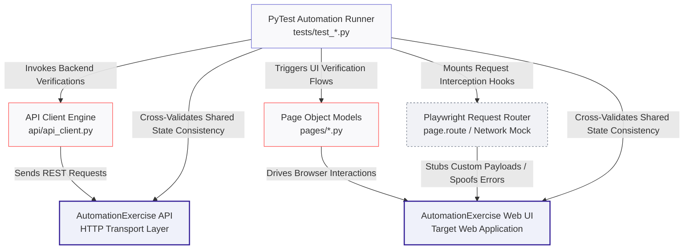

# 🎭 Playwright API + UI Hybrid Test Framework

[](https://github.com)
[](https://playwright.dev)
[](https://pytest.org)

---

## 🎯 About The Project
A production-ready, hybrid test automation framework combining high-speed API testing and functional UI verification using **Playwright** and **Python**. The suite executes automated sequences against the public testing application profile **Automation Exercise** (`automationexercise.com`).

This architecture demonstrates advanced cross-validation and traffic interception techniques—including network mocking, custom non-standard response extraction, and continuous verification loops—establishing capabilities that set Playwright apart from traditional Selenium or Appium setups.

### 🛠️ Technology Stack Breakdown
* **Core Engine:** Playwright Web Driver + Request Contexts (Handles asynchronous element selectors and raw API network streams simultaneously)
* **Test Architecture Runner:** PyTest Engine (Provides modular fixture injection, browser context overrides, and parameter matrix distribution)
* **Structural Design Patterns:** Page Object Model - POM (Encapsulates UI views) coupled with the API Client Pattern (Abstracts backend endpoints)
* **Observability Telemetry:** Allure Test Reports & GitHub Actions (Compiles interactive validation timelines, logs, and trace files)

---

## 🕹️ Interactive Navigation
* [🏗️ Hybrid System Runner Architecture](#-hybrid-system-runner-architecture)
* [📋 Framework Component Matrix](#-framework-component-matrix)
* [📂 Directory Blueprint](#-directory-blueprint)
* [🚀 Local Machine Setup](#-local-machine-setup)
* [🚦 Running Test Execution Matrix](#-running-test-execution-matrix)
* [💡 Strategic Design Implementations](#-strategic-design-implementations)

---

## 🏗️ Hybrid System Runner Architecture



---

## 📋 Framework Component Matrix

| Framework Module Component | Layer Scope Target | Strategic Test Execution Objective |
| :--- | :--- | :--- |
| **PyTest Engine Core** | Test Orchestration (`tests/`) | Directs execution pipelines, manages multi-browser contexts, and structures cross-layer assertions. |
| **API Client Engine Layer** | Backend Interface Wrapper (`api/`) | Isolates underlying endpoints, processes JSON models, and parses non-standard transport packets. |
| **Page Object Components (POM)** | Frontend Interaction Layer (`pages/`) | Maps dynamic locators (text matchers, data tags) and encapsulates UI click/fill workflows. |
| **Playwright Route Interceptor** | Network Virtualization Node | Hooks into low-level browser context sockets to intercept, stall, or alter live traffic on the fly. |
| **GitHub Actions Pipeline** | Continuous Integration Engine | Provisions environments, executes background matrix runs, and archives visual test artifacts. |

---

## 📂 Directory Blueprint

```text
playwright-api-ui-hybrid/
├── .github/workflows/
│   └── test-pipeline.yml      # GitHub Actions CI automated workflow orchestrator
├── api/                       # API Client Layer: Abstracts backend rest integrations
│   └── api_client.py          # Base request helper handling custom transport schemas
├── pages/                     # Page Object Model Layer: Abstracts frontend web selectors
│   ├── base_page.py           # Core explicit wait conditions and browser wrappers
│   └── products_page.py       # E-commerce item catalogue elements and locator interactions
├── tests/                     # Verification Execution Suite
│   ├── test_api_products.py   # Isolated fast backend API endpoint testing matrix
│   ├── test_ui_products.py    # Isolated structural browser web UI validation scripts
│   ├── test_network_mocking.py# Advanced network request manipulation and failure injection
│   └── test_consistency.py    # Cross-validation engine matching API responses vs UI states
├── pytest.ini                 # PyTest runner settings, tracking tags, and root paths
├── requirements.txt           # Python software dependency configuration sheets
└── README.md                  # Comprehensive framework master technical map
```

---

## 🚀 Local Machine Setup

### 1. Clone the project and step into the local repository directory
```bash
git clone https://github.com/PallawiGupta20/playwright-api-ui-hybrid.git
cd playwright-api-ui-hybrid
```

### 2. Configure the isolated Python Virtual Environment
```bash
python3 -m venv venv
source venv/bin/activate
```

### 3. Deploy system framework runtime dependencies and browser engines
```bash
pip install -r requirements.txt
playwright install
```

---

## 🚦 Running Test Execution Matrix

### 1. Complete Suite Run (Headless Cross-Layer Execution)
```bash
pytest -v
```

### 2. Fast Target API Core Run (Bypasses UI Render Engines Completely)
```bash
pytest tests/test_api_products.py -v
```

### 3. Headed UI Layout Validation Run (Launches Visible Browser Views)
```bash
pytest tests/test_ui_products.py --headed -v
```

### 4. Cross-Browser Engine Target Run (Swaps Default Chromium Configuration)
```bash
pytest --browser firefox -v
```

---

## 💡 Strategic Design Implementations

* **Custom Response Extraction:** The target `automationexercise.com` API structure consistently responds with a standard HTTP transport status `200 OK`, masking actual internal application layer failures. Tests are explicitly engineered to extract and parse the internal JSON body block's `responseCode` attribute rather than verifying standard HTTP network values blindly.
* **Cross-Layer Data Consistency Engine:** The `test_api_ui_consistency.py` suite explicitly extracts dynamic object maps directly from the database API layers and programmatically evaluates them against elements extracted from the web view interfaces. This setup detects data discrepancies that separate UI or API validations alone would fail to catch.
* **Advanced Network Request Interception:** Leverages Playwright's low-level `page.route` architecture inside `test_network_mocking.py` to transparently capture, intercept, and rewrite live API request streams. This securely simulates application errors, broken servers, or simulated connection throttling without requiring edits to actual backend environments.
